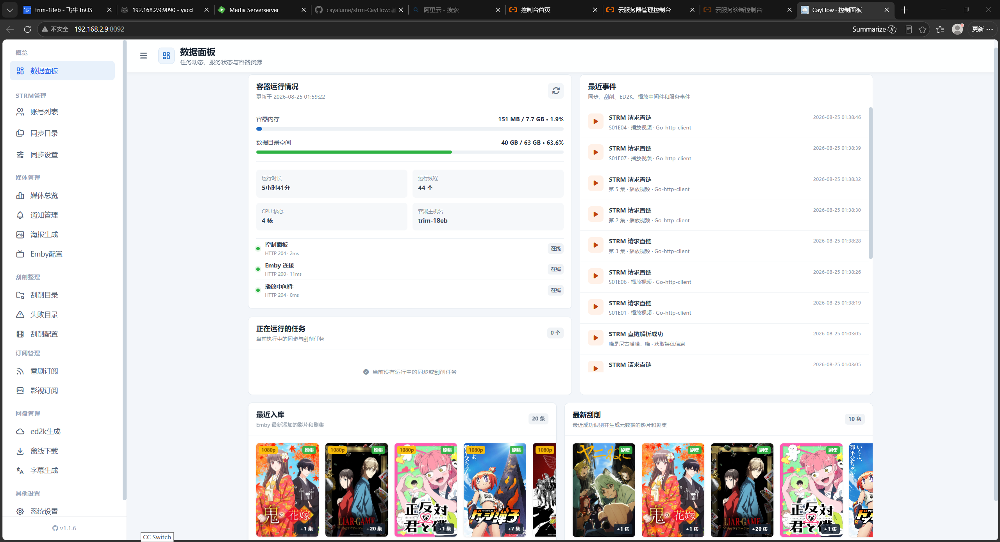
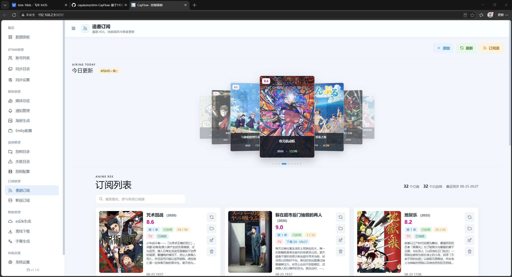
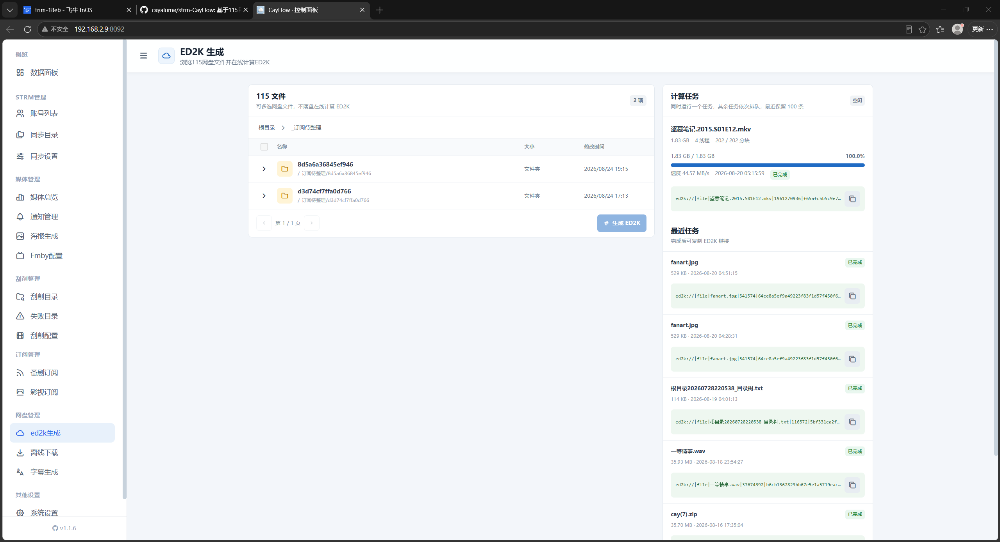
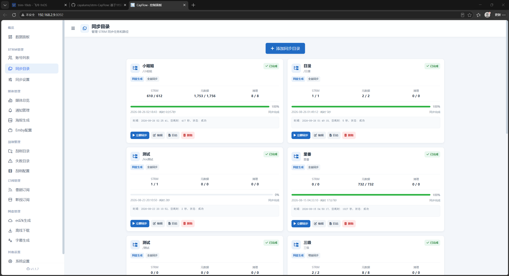
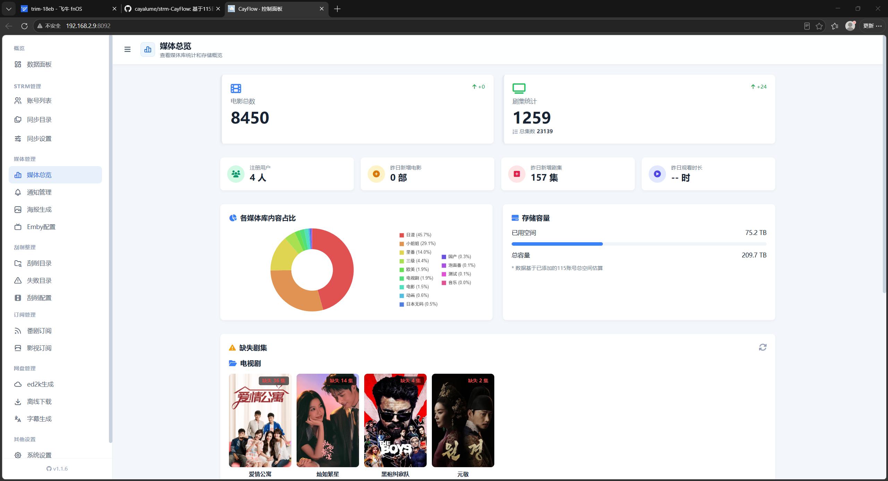

<h1 align="center">Strm-CayFlow</h1>

<p align="center">
  <b>115 网盘 · STRM · Emby 一站式自动化面板</b><br>
  <sub>订阅追更 → 离线下载 → 自动刮削 → 生成 STRM → Emby 入库 → 302 直连播放，一条链路全自动</sub>
  <p align="center"><sub>如果这个面板帮你省下了整理媒体库的时间，动动小手点一个 ⭐ Star</sub></p>
</p>

<p align="center">
  <a href="https://hub.docker.com/r/cayalume/strm-cayflow"></a>
  <a href="https://hub.docker.com/r/cayalume/strm-cayflow/tags"></a>
  
  
  
  <a href="https://t.me/strm_cayflow"></a>
<a href="https://qm.qq.com/cgi-bin/qm/qr?...&group_code=1109333617"></a>
</p>

<p align="center">
  <a href="#-快速开始">快速开始</a> ·
  <a href="#-功能">功能</a> ·
  <a href="#-strm-生成与同步">STRM</a> ·
  <a href="#-刮削">刮削</a> ·
  <a href="#-订阅追更">订阅</a> ·
  <a href="#-播放与-302">播放</a> ·
  <a href="#-常见问题">常见问题</a> ·
  <a href="#-更新日志">更新日志</a>
</p>

## 📌 这是什么

一个跑在自己 NAS / 服务器上的 **Web 面板**，把 115 网盘变成 Emby / Jellyfin 能直接播放的媒体库。

你只需要配一次：绑上 115、建一个 STRM 库、填 TMDb 和 Emby 的 Key。之后新片进来，订阅会自己发现、自己下、自己刮、自己入库；你在 Emby 里点播放就行。

和常见的「挂载 + 直链」方案比，它有三件事不太一样：

- **不挂载、不转存**：STRM 里只是一个取链地址，网盘上的文件原样不动
- **播放不经服务器**：302 把播放器直接甩给 115 CDN，NAS 只出一个跳转，带宽和 CPU 都省下来
- **分享链接也能入库**：别人的分享不需要转存到自己网盘，生成 STRM 就能播，不占一点空间

适合已经用 115 + Emby、想把「找资源 → 下载 → 整理 → 入库 → 播放」这条链路彻底自动化的人。

## ✨ 功能

| 模块 | 能力 |
| :--- | :--- |
| 🗂 **STRM 同步** | 按 115 目录树批量生成 `.strm`，全量 / 增量两种模式，元数据可复制 / 删除 / 上传，支持定时与手动中断 |
| 🎬 **自动刮削** | 认片名 → 匹配 TMDb（标题 + 年份 + 别名多轮回退）→ 生成标准 NFO 与 poster / fanart / logo / 剧集缩略图，自动归类 `电影/` `剧集/` |
| 📡 **订阅追更** | 内置 nyaa / 蜜柑 / 动漫花园，输入番名即可：抓取 → 115 离线 → 刮削 → 同步一条龙；影视订阅支持夸克资源转 ed2k |
| ▶️ **302 播放** | 改写 PlaybackInfo 后直连 115 CDN；直链缓存 + 并发合并 + Lavf 节流，起播快且不触发风控 |
| 🔗 **分享生成 STRM** | 别人的分享链接直接生成 STRM 并 302 播放，**不转存、不占网盘空间** |
| 🖼 **海报生成** | 一键为整个媒体库生成海报墙，按库配 Cron，内置中英文字体排版 |
| 💬 **AI 字幕** | 优先提取内封字幕；没有就调语音模型听写、再调翻译模型，输出 SRT，支持批量 |
| 🧲 **ed2k / 离线** | 在线流式算 ed2k（不下载不落盘）、磁力批量提交 115、Telegram 发链接即建任务 |
| 🤖 **数据与通知** | Emby 播放时长 / 最近添加 / 缺失集看板，Telegram 多渠道推送播放、入库、任务状态 |

**几个细节**

- 全量同步首次建库用，之后切增量：只处理缺失部分，API 调用从几千降到几十
- 刮削支持**本地 STRM 目录**和**网盘目录**两种来源，网盘模式直接改云端文件名和目录
- 订阅模式带三道闸门（内容校验 / 集数区间 / 同集去重），防的是「同名不同番」「上一季当新季」「一集入库两份」

## 📷 界面预览

<p align="center">
  
<p align="center">
  
  
</p>

<p align="center">
  
  
</p>

<sub>卡片式布局，桌面三列、手机两列自适应。</sub>

## 🚀 快速开始

三步跑起来。镜像 `amd64` / `arm64` 双架构，地址见 [Docker Hub](https://hub.docker.com/r/cayalume/strm-cayflow)。

### 1. 建目录

```bash
mkdir -p /opt/strmflow/data
touch /opt/strmflow/config.json    # 先建空文件，首次启动会写入默认配置
```

### 2. 起容器  

docker run
```bash
docker run -d \
  --name strm-cayflow \
  --restart=always \
  --network host \
  -v /volume1:/volume1 \
  -v /opt/strmflow/config.json:/app/config.json \
  -v /opt/strmflow/data:/app/data \
  -e TZ=Asia/Shanghai \
  cayalume/strm-cayflow:latest
```

Docker Compose
```yaml
services:
  strm-cayflow:
    image: cayalume/strm-cayflow:latest
    container_name: strm-cayflow
    restart: always
    network_mode: host
    volumes:
      - /volume1:/volume1
      - /opt/strmflow/config.json:/app/config.json
      - /opt/strmflow/data:/app/data
    environment:
      - TZ=Asia/Shanghai
      # 需要访问 TMDb / Telegram 时再加代理
      # - HTTP_PROXY=http://192.168.1.2:7890
      # - HTTPS_PROXY=http://192.168.1.2:7890
```

> `network_mode: host` 下端口直接共享宿主机，不需要再写 `ports`。

</details>

### 3. 打开面板

浏览器访问 `http://你的IP:8092`，默认账号 `admin` / 密码 `admin`，**登录后立刻改密码**。

### 参数说明

| 参数 | 说明 |
| :--- | :--- |
| `--network host` | 必须使用 host 网络；8091 / 8092 都要被 Emby 和播放器直接访问 |
| `-v /volume1:/volume1` | STRM 输出目录与媒体库，Emby 读的是这里 |
| `-v /opt/strmflow/config.json:/app/config.json` | 全部配置：115 账号、库、TMDb、通知渠道 |
| `-v /opt/strmflow/data:/app/data` | 任务、日志、缓存、统计、刮削产物 |
| `-e HTTP_PROXY` / `HTTPS_PROXY` | 访问 TMDb、Telegram 的出口；局域网服务不走它 |
| `-e TZ` | 时区，影响定时任务触发时间 |

### 系统要求

| 项 | 要求 |
| :--- | :--- |
| 系统 | Linux（群晖 / 威联通 / Unraid / 任意 x86、ARM 主机） |
| 内存 | ≥ 512MB（刮削与同步是外部进程，常驻占用很低） |
| 磁盘 | STRM 与元数据很小；若开启元数据复制，按库大小预留 |
| 网络 | 能访问 115；刮削需要 TMDb（可自建反代） |
| 端口 | `8092` 面板、`8091` 反代emby，均需放行 |

## ⚙️ 首次配置

1. **改密码**：登录后在「系统设置」里改掉默认账号密码。
2. **绑 115**：进「账号管理」扫码登录，成功后显示昵称与容量。
3. **填 TMDb**：在「刮削配置」填 API Key；访问不了官方域名就填反代地址
4. **填 Emby**：地址 + API Key，保存后能读到媒体库列表即成功。
5. **建 STRM 库**：选 115 源目录 → 选本地挂载点 → 先跑一次**全量**同步。
6. **Emby 加库**：新增媒体库指向 STRM 目录，扫描完就能看到片。

> ⚠️ **别跳过第 5 步的全量同步。** 增量模式是「对比已有目录树补差」，没有全量打底会漏文件。

## 🗂 STRM 生成与同步

### 两种同步模式

| 模式 | 行为 | 调用量 | 什么时候用 |
| :--- | :--- | :--- | :--- |
| 全量 | 拉取指定目录全部数据，重建 STRM | 大（按文件数线性增长） | 首次建库、目录大改 |
| 增量 | 对比已有目录树，只补缺失部分 | 小（几十次请求） | 日常定时任务 |

首次必须跑全量，之后才能切增量。

### 元数据三种处理

| 模式 | 说明 |
| :--- | :--- |
| 复制 | 网盘上的 `.nfo` / 图片拉到本地 STRM 目录，Emby 直接读 |
| 删除 | 清理本地多余的元数据文件，保持与网盘一致 |
| 上传 | 本地改好的元数据推回网盘 |

### 分享生成 STRM

这是 v1.1.0 之后的一个特殊能力：**不转存，直接播**。

别人给你一个 115 分享链接，正常流程是「转存到自己网盘 → 占空间 → 再生成 STRM」。这里可以跳过转存，直接把分享文件生成 STRM 并 302 播放：

- 不占用你自己的网盘空间
- 不需要等转存完成
- 播放体验和本地库一致，仍然走 302 直连

适合临时看片、或者分享源本身不方便长期保存的场景。


## 🎬 刮削

从文件名或目录名认出作品，拉 TMDb 数据，写成 Emby 能读的 NFO 和图片。

```
扫描 → 识别类型（电影 / 剧集）→ 提取片名 + 年份 + 别名
     → 搜索 TMDb → 标题与年份打分选优
     → 下载元数据与图片 → 写 NFO → 整理目录与文件名
```

### 匹配策略

- 标题 + 年份 + 别名三路并查，别名包含繁体、日文原名、罗马字
- 完全相等优先，其次去变音符 / 去标点比较，最后才走相似度兜底（阈值 0.86）
- 年份默认容差：电影 ±1 年、剧集 ±3 年，避免把翻拍认错
- 模糊命中时要求年份完全一致，宁可不出结果也不乱配

### 产出结构

| 类型 | 结构 |
| :--- | :--- |
| 电影 | `片名 (年份) {tmdbid=xxx}/片名.mkv` + `片名.nfo` + `poster.jpg` + `fanart.jpg` + `logo.png` |
| 剧集 | `剧名 (年份) {tmdbid=xxx}/tvshow.nfo` + `Season 1/剧名 - S01E01.nfo` + 每集缩略图 |
| 分类 | 自动落到 `电影/` 或 `剧集/` 子目录，可关闭 |

### 失败处理

刮削失败的条目会单独进「失败目录」页，可以：

- 看到具体原因（未匹配 / 年份不符 / 集数越界 / 上传失败）
- 手动填标题、类型、季集号，再单独重刮
- 批量重试，不用重新扫全库

## 📡 订阅追更

### 番剧订阅

内置 nyaa、蜜柑、动漫花园的 RSS 源与规则，开箱即用。

1. 输入番名，从 TMDb 搜索结果里选作品
2. 设定季数、集数区间、画质偏好
3. 之后每轮自动：抓 RSS → 过滤规则 → 提交 115 离线 → 完成后刮削 → STRM 同步

**洗版**：新资源画质更高时替换旧版本。替换前会先读 Emby 库里已有媒体的分辨率与码率，确认真的更好才动手，避免拿 720p 覆盖 4K。

### 影视订阅

- 按 TMDb 条目订阅电影 / 剧集，支持热门榜与海报浏览
- 资源来自观影站，可以填自定义夸克资源链接并优先使用
- 夸克资源 → 转 ed2k → 上传 115；网盘里没有 ed2k 时自动回退到流式 / 分片上传

### 任务队列

订阅产生的每个任务都能单独看到状态：排队 / 下载中 / 刮削中 / 完成 / 失败。失败可单条重试或取消，不会因为一条卡住整个队列。

## ▶️ 播放与 302

面板启动两个端口，各管一件事：

- **8092**：Web 界面 + `/api/play` 取链
- **8091**：播放中间件，给 Emby 用

```
Emby 播放 STRM
      │
      ├─ 8091 改写 PlaybackInfo，返回可直连的入口
      ▼
  /api/play?pickcode=xxx
      │  命中缓存（50 分钟）→ 直接 302
      │  未命中 → 115 取链 → 写缓存 → 302
      ▼
  115 CDN（媒体字节不经过 NAS）
```

### 为什么起播快

| 机制 | 作用 |
| :--- | :--- |
| 直链缓存 | 同一客户端重播同一集，不再向 115 取链 |
| 并发合并 | 同一视频的多个并发请求只取一次链，其余等结果 |
| Lavf 节流 | Emby 探测与转码的取链单独排队，不同资源之间保持间隔 |
| UA 分流 | Infuse / VLC / Hills 等 UA 不一致的客户端走本地中继，保留签名 UA |

### 分享模式

分享生成的 STRM 走同一条链路，一样是 302 直连，不需要先把文件转存到自己网盘。

## 🖼 海报与字幕

### 海报生成

- 按媒体库生成海报墙，一个库一套配置
- 每个库可配独立的 Cron 定时任务
- 内置中英文字体（`ch.ttf` / `en.otf`），中文标题不会变成方框
- 生成过程有独立日志，出错能看到具体哪张图

### AI 字幕

```
选择本地 .strm → 取视频直链 → 提取音轨
      ├─ 有内封字幕 → 直接提取
      └─ 无内封字幕 → 语音模型听写 → 翻译模型翻译
                              ↓
                         输出 SRT
```

- 模型接口兼容 OpenAI 格式，官方或中转都行
- 支持批量处理，任务状态可查
- 优先用内封字幕，省一次转写，也避免机器听写带来的错字

## 🧲 ed2k 与离线下载

**ed2k 生成**：在线流式计算网盘文件的 ed2k 链接，不下载、不落盘。支持多选批量，生成完可推送到通知渠道。

**离线下载**：粘贴磁力或 ed2k，按换行自动拆分，批量提交到 115 指定目录。也能直接在 Telegram 里发链接给机器人建任务。

## 🧩 其他细节

散在设置里、但直接决定好不好用的那些：

- **STRM 覆盖**：默认不覆盖已有文件，避免同步时冲掉手工修正过的内容
- **同步后刷新 Emby**：可指定同步完成后自动刷新哪个媒体库，省掉手动点一次
- **目录浏览器**：选 115 路径不用手输，直接点
- **重命名策略**：电影 / 剧集分别控制是否按 `片名 (年份) {tmdbid}` 重命名
- **元数据大小比对**：开启后只复制比本地更大的文件，减少无效传输
- **定时任务**：同步、刮削、海报、订阅各自独立 Cron，互不阻塞
- **多 115 账号**：可存多个账号，Cookie 只留在服务端，接口不回传给浏览器
- **Telegram 机器人**：多渠道、可自定义 API 地址、按规则过滤；菜单里能直接触发同步、刮削、云下载

## 📂 数据目录

```text
/app/data
├── logs/                      # 同步 / 刮削 / 订阅任务日志（每个任务一个文件）
├── scraper_stats_<id>.json    # 任务统计：成功数、元数据产出、输出路径
├── scraper_failures_<id>.json # 失败明细，供「失败目录」页读取与重试
├── scrape_recent.json         # 最近入库记录，仪表盘与媒体卡片用
├── 115_dircache.json          # 115 目录树缓存，减少重复列目录
├── poster.log                 # 海报生成日志
└── file.db / media_cache.db   # 媒体索引缓存
```

### 升级

```bash
docker pull cayalume/strm-cayflow:latest
docker rm -f strm-cayflow
# 用原来的 docker run / compose 命令重新启动
```

**升级只需保留 `/app/data` 和 `config.json`**，其余都可重建。建议升级前备份：

```bash
tar czf strmflow-$(date +%F).tar.gz -C /opt/strmflow config.json data
```

## ❓ 常见问题

<details>
<summary><b>面板打不开 / 端口连不上</b></summary>

<br>

- 确认用了 `--network host`，此模式下 `-p` 参数无效
- 确认宿主机防火墙放行 `8092`（面板）和 `8091`（播放中间件）
- 看容器是否在跑：`docker ps | grep strm`
- 看启动日志：`docker logs --tail 50 strm-cayflow`

</details>

<details>
<summary><b>播放一直转圈，两台设备同播只有一台能播</b></summary>

<br>

这是 115 的限制，不是面板的问题。

实测同一文件同时只能维持约 **2 条**活跃连接，第 3 条起返回：

```
403 {"message":"115 pmt 3-2"}
```

所以两台以上设备同时播同一部片时，后开的会一直加载，直到先开的暂停、释放连接。

换 CDN 域名、换 UA、重复取链都绕不过——额度是按「账号 + 文件」计的。

要多人同播，只能在前面加一层自己写的流复制中继（一条上游扇出多路），代价是 NAS 上行要承载 N × 码率。

</details>

<details>
<summary><b>刮削提示 NFO 生成失败：Access denied by bucket policy</b></summary>

<br>

115 的上传分两步：先按 SHA1 问「库里有没有」，有就**秒传**；没有才走 OSS 直传。

这个报错说明 **OSS 直传通道当前不可用**，与文件类型无关。表现为：

- 图片（TMDb 公共资源，115 库里早就有）→ 秒传成功
- NFO（本地生成、内容唯一）→ 必须真实上传 → 全部失败

判断是否恢复，要用**每次不同**的内容测，否则第一次成功过之后会被秒传骗过：

```bash
docker exec strm-cayflow sh -c 'U=$(date +%s%N); printf "$U" > /tmp/z.txt && 115tool upload "$(python3 -c "import json;print(json.load(open(\"/app/config.json\"))[\"accounts\"][0][\"cookie\"])")" /tmp/z.txt "/刮削/测试/z_$U.txt"'
```

返回 `ok:true` 才是真恢复。恢复后去「失败目录」页批量重试，视频已在库，只会补 NFO。

</details>

<details>
<summary><b>刮削匹配不到，或者配错片</b></summary>

<br>

按顺序排查：

1. **拼音文件名**：`Se.Jie.Qing.Di.2014` 这种纯拼音，TMDb 搜不到，手动填中文标题或先改名
2. **年份不对**：文件名里的年份和 TMDb 差太多，会被年份闸门拦下，手动填正确年份
3. **同名作品太多**：在结果里手动指定 tmdbid
4. **剧集被识别成电影**：字幕组命名没有集号，可手动指定类型

「失败目录」页每条都有具体原因，比看日志快。

</details>

<details>
<summary><b>外网播放失败</b></summary>

<br>

STRM 里写的是面板地址。外网播放需要：

1. 给面板配好反向代理或内网穿透（必须能访问到 `8092`）
2. 把 `default_strm_prefix` 改成外网地址
3. 重新生成 STRM（旧文件里还是内网地址）

如果只在家里看，跳过这一节。

</details>

<details>
<summary><b>同步很慢，或者报 405 / 412</b></summary>

<br>

网盘风控。115 对高频请求比较敏感，尤其递归遍历大目录。

- 首次全量拆成几个小目录，分批跑
- 全量完成后切增量
- 撞到 405 / 412 立刻停，等 10 分钟到 1 小时自动恢复
- 恢复后先小批量验证，不要连续重试

</details>

<details>
<summary><b>Emby 里看不到片 / 显示成文件夹</b></summary>

<br>

1. 确认 STRM 文件确实生成了（本地目录里能看到 `.strm`）
2. 确认 Emby 媒体库指向的是 STRM 根目录，而不是 115 挂载目录
3. 在 Emby 里对该库执行「刷新元数据」，必要时先移除库再重新添加
4. 播放时如果报错，先直接访问 `http://NAS:8092/api/play?pickcode=...` 看是否 302

</details>

<details>
<summary><b>订阅不追更 / 任务一直排队</b></summary>

<br>

- 看「订阅」页该作品的状态是不是被暂停
- 看 RSS 源是否能访问（部分源需要代理）
- 看任务队列里是否有卡住的历史任务，先取消再重试
- 追更依赖 115 离线，离线任务本身失败时订阅不会推进，去「离线下载」页看具体原因

</details>

## 📦 更新日志

<details open>
<summary><b>🚀 v1.2.1</b> · <code>2026-10-19</code></summary>

<br>

- ⚡ 优化刮削流程
- ⚡ 优化订阅逻辑
- ✨ 观影订阅新增自定义夸克资源链接，优先使用此链接进行追更

</details>

<details>
<summary><b>🧩 v1.2.0</b> · <code>2026-09-12</code></summary>

<br>

- ⚡ 优化反查标题逻辑
- 🐛 修复某些情况下播放视频失败问题
- 🐛 修复观影订阅页面显示异常问题

</details>

<details>
<summary><b>🧩 v1.1.9</b> · <code>2026-09-03</code></summary>

<br>

- 🐛 修复观影登录失败问题

</details>

<details>
<summary><b>🧩 v1.1.8</b> · <code>2026-09-02</code></summary>

<br>

- ✨ 账号添加改为扫码自动获取 Cookie
- ✨ 新增影视订阅页面
  - 支持夸克网盘资源转 ed2k 链接再上传至 115，网盘内无 ed2k 资源时自动回退至流式 / 分片上传
  - 目前仅支持观影内数据订阅
- 🐛 修复 ed2k 生成页面频繁获取直链导致封控问题
- 🐛 修复番剧订阅各种刮削失败问题

</details>

<details>
<summary><b>🧩 v1.1.7</b> · <code>2026-08-25</code></summary>

<br>

- 🐛 修复某些情况下 302 播放会走服务器流量
- ⚡ 优化播放中间件，提高起播速度

</details>

<details>
<summary><b>🧩 v1.1.6</b> · <code>2026-08-24</code></summary>

<br>

- ✨ 新增番剧订阅页面
  - 离线刮削同步一条龙
  - 预设 nyaa、蜜柑、动漫花园源和规则，开箱即用
  - 支持洗版等多个规则
  - 优先读取 Emby 库中媒体信息，再决定是否替换库中版本
- ⚡ 优化播放中间件，现已支持网页 302 播放视频

</details>

<details>
<summary><b>🧩 v1.1.5</b> · <code>2026-08-19</code></summary>

<br>

- ✨ 通知规则新增 ed2k 生成完成通知
- ✨ 新增 AI 字幕生成页面
  - 需要自备模型 API，第三方中转或官方都行
  - 选择本地 STRM 文件获取视频直链
  - 提取视频音轨进行听写翻译
  - 优先使用内封字幕进行翻译

</details>

<details>
<summary><b>🧩 v1.1.4</b> · <code>2026-08-17</code></summary>

<br>

- 🐛 修复刮削目录账号选项消失导致无法刮削本地文件问题
- 🐛 修复同步增量模式还在启用文件对比导致同步慢和 405 问题
- 🐛 修复 302 播放失败问题

</details>

<details>
<summary><b>🧩 v1.1.3</b> · <code>2026-08-16</code></summary>

<br>

- ✨ 新增离线下载页面，自动识别磁力和 ed2k 链接提交到网盘指定目录
- ✨ 新增刮削失败目录页面，失败的视频可以手动修改再刮削
- ✨ ed2k 生成支持多选
- ⚡ 优化同步时下载元数据流程，大量下载元数据时减少 405 封控
- ⚡ 优化刮削流程和逻辑
- ⚡ 优化中间件日志
- 🐛 修复刮削 / 同步目录中网盘文件浏览控件报错

</details>

<details>
<summary><b>🧩 v1.1.2</b> · <code>2026-08-12</code></summary>

<br>

- ✨ 新增数据面板页面：实时监听各种事件，媒体卡片移至此页
- ✨ 新增 ed2k 生成页面：流式在线计算网盘文件 ed2k，不占用本地空间
- ✨ 每个任务卡片新增进度条，实时刷新
- ✨ 同步设置新增文件大小对比选项，仅全量同步生效
- 🔧 移除 embyExternalUrl 依赖，自写播放中间件
- ⚡ 媒体库刷新通知、日志 id 改为库名
- ⚡ 优化刮削、同步任务结束后内存不立即释放问题
- ⚡ 大幅重构 UI，减少内存占用

</details>

<details>
<summary><b>🧩 v1.1.1</b> · <code>2026-08-03</code></summary>

<br>

- 🐛 修复刮削目录多个问题
- ⚡ 优化媒体总览页面，加载速度大幅提高

</details>

<details>
<summary><b>🧩 v1.1.0</b> · <code>2026-08-02</code></summary>

<br>

- ✨ 新增分享生成 STRM 选项
  - 不占用网盘空间
  - 不需要转存文件
  - 仅通过分享链接即可实现 302 重定向播放
- ⚡ 优化刮削流程

</details>

<details>
<summary><b>🧩 v1.0.9</b> · <code>2026-07-10</code></summary>

<br>

- 🐛 修复通知渠道某些情况保存写入失败问题
- ⚡ 优化任务失败提示
- ⚡ 优化 302 服务，cookie 每次变化都会重启服务，避免提取直链失败
- ⚡ 优化通知渠道，每次保存配置都会重启机器人，避免提示权限不足

</details>

<details>
<summary><b>🧩 v1.0.8</b> · <code>2026-07-09</code></summary>

<br>

- ✨ 新增全量 / 增量同步模式
  - 全量同步：一次性拉取指定目录所有数据，调用大量 API
  - 增量同步：对比目录树仅拉取缺失文件目录，调用少量 API
  - 首次执行任务必须进行一次全量同步，后续可选择增量同步
- 🐛 修复远程浏览 115 路径触发 405 问题
- 🐛 修复生成 STRM 时不管有没有勾选覆盖选项都覆盖生成问题
- ⚡ 优化元数据下载流程

</details>

<details>
<summary><b>🧩 v1.0.7</b> · <code>2026-07-08</code></summary>

<br>

- ✨ 同步目录新增 STRM 覆盖选项
- ✨ 同步目录新增目录浏览器
- ⚡ 优化同步任务，减少 405 提示
- ✨ v1.0.6：新增支持 arm / amd 双平台架构
- ✨ v1.0.6：新增同步下载时元数据失败重试机制
- ⚡ v1.0.6：优化 302 中间件，内存占用更小
- ⚡ v1.0.6：优化刮削脚本减少风控
- 🐛 v1.0.6：修复上传文件到网盘失败问题
- 🐛 v1.0.6：修复使用机器人添加云下载失败时不显示失败原因

</details>

<details>
<summary><b>🧩 v1.0.5</b> · <code>2026-06-16</code></summary>

<br>

- 🔧 移除 alist / openlist 依赖并移除整个 302 配置页面，现在直接通过 API 获取直链重定向播放

</details>

<details>
<summary><b>🧩 v1.0.4</b> · <code>2026-06-11</code></summary>

<br>

- ✨ 媒体总览页面新增缺失剧集卡片
- ⚡ 优化刮削脚本

</details>

<details>
<summary><b>🧩 v1.0.3</b> · <code>2026-06-02</code></summary>

<br>

- ✨ 新增媒体总览页面：调用 Emby API 获取库内电影 / 剧集总数、今日昨日新增
- ✨ 新增 TG 机器人菜单：可调用机器人执行同步 / 刮削，磁力与 ed2k 直接发给机器人即可云下载
- ✨ 同步任务新增「完成后刷新指定媒体库」
- 🔧 弃用原 CSS 方案，重构所有页面 UI
- 🔧 移除对 cd2 等挂载软件依赖，元数据操作改走 API

</details>

<details>
<summary><b>🧩 v1.0.2</b> · <code>2026-05-22</code></summary>

<br>

- ✨ 同步任务：元数据支持删除 / 上传 / 复制，增加定时执行与完成通知
- ✨ 刮削任务：增加定时执行与完成通知
- ✨ TG 通知新增视频播放 / 暂停 / 结束进度条
- ⚡ 重构所有模态框 UI
- ⚡ 优化刮削逻辑，适配大部分文件命名
- 🐛 修复整理目录为空时刮削失败，现在会在刮削目录原地整理

</details>

<details>
<summary><b>🧩 v1.0.1</b> · <code>2026-05-06</code></summary>

<br>

- ✨ 新增刮削功能
  - 自动识别电影或剧集
  - 支持本地刮削和网盘刮削
  - 支持自定义 TMDb API 和图像地址
  - 可选重命名文件夹为 `片名 (年份) {tmdbid}`
  - 自动整理分类，在整理目录创建 `电影/` `剧集/` 文件夹

</details>


## ⚠️ 免责声明

- 本项目仅用于**个人学习与技术研究**，不提供任何资源内容，也不存储任何受版权保护的文件。
- 所有数据均来自公开网络，由使用者自行配置的账号与网络环境获取，**使用者需自行承担合规责任**。
- 请勿用于商业用途、二次分发或任何违反当地法律法规的场景。
- 因使用本工具导致的账号封禁、数据丢失等后果，由使用者自行承担。
